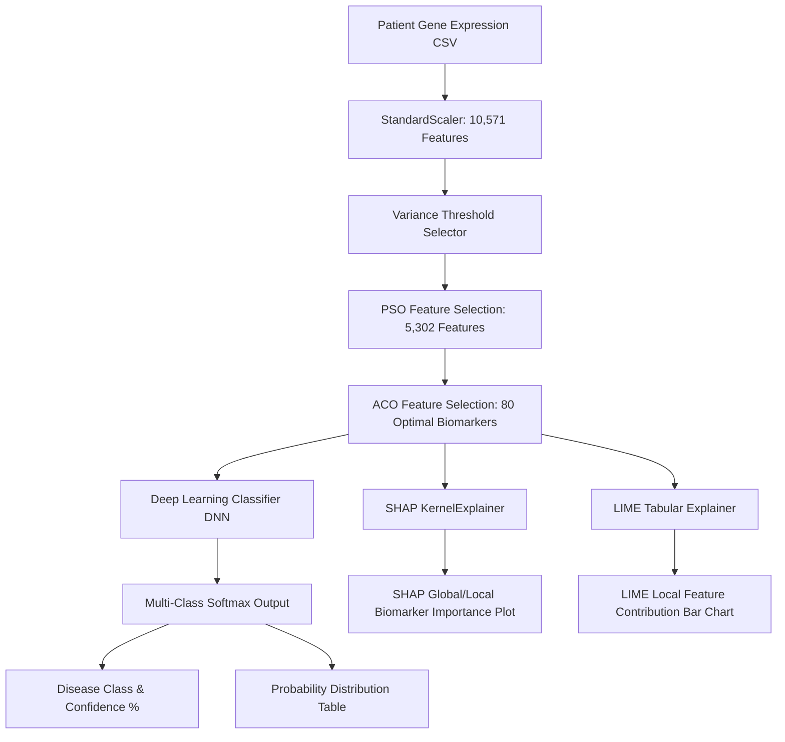

<div align="center">

# 🧬 Explainable Multi-Disease Diagnosis System
### Gene Expression–Based Disease Prediction using Hybrid Swarm Intelligence (PSO + ACO) and Deep Learning


</div>

---

## 📌 Overview

This project provides an end-to-end clinical decision-support application for multi-disease diagnosis based on high-dimensional gene expression profiles (microarray data). It integrates a multi-stage feature selection pipeline combining **Variance Filtering**, **Particle Swarm Optimization (PSO)**, and **Ant Colony Optimization (ACO)** with a **Deep Neural Network (DNN)** and **Explainable AI (XAI)** interpretability engines (**SHAP** & **LIME**).

### 🎯 Target Diseases
| Class ID | Disease | GEO Dataset Reference |
| :--- | :--- | :--- |
| **0** | **Coronary Artery Disease (CAD)** | GSE66360 |
| **1** | **Autoimmune Disease** | GSE50772 |
| **2** | **Alzheimer's Disease** | GSE48350 |
| **3** | **Parkinson's Disease** | GSE6613 |

---

## 🏗️ Architecture & Pipeline Flow



### 1. Data Preprocessing & Hybrid Swarm Feature Selection
High-dimensional microarray datasets typically have thousands of gene probe features with severe sparsity and redundancy. The application uses a multi-tier reduction strategy:
1. **StandardScaler (`scaler.pkl`)**: Standardizes 10,571 gene expression probe values.
2. **Variance Thresholding (`variance_selector.pkl`)**: Filters out zero/low-variance features across patients.
3. **Particle Swarm Optimization (PSO - `pso_features.pkl`)**: Explores global feature space to reduce dimensions to 5,302 relevant candidate genes.
4. **Ant Colony Optimization (ACO - `aco_features.pkl`)**: Fine-tunes selection using pheromone-based heuristic search down to **80 optimal biomarker genes**.

### 2. Deep Learning Classifier (`hybrid_pso_aco_dl_model.keras`)
- **Input Dimension**: `(Batch, 80)`
- **Hidden Layers**:
  - `Dense(64, activation='relu')` + `Dropout`
  - `Dense(32, activation='relu')` + `Dropout`
- **Output Layer**: `Dense(4, activation='softmax')` producing probabilities across all 4 target diseases.

### 3. Explainable AI (XAI) Framework
- **SHAP (SHapley Additive exPlanations)**: Utilizes a `KernelExplainer` initialized on reference training features (`X_train_fs.npy`) to measure the exact Shapley contribution of the top 10 biomarker genes toward the predicted diagnosis.
- **LIME (Local Interpretable Model-agnostic Explanations)**: Employs `LimeTabularExplainer` to build local linear surrogate models explaining how specific gene values push the prediction toward or against a disease class.

---

## 📂 Project Structure

```
gene_disease_app/
├── app.py                            # Streamlit entry point (landing page)
├── run.sh                            # One-click startup shell script
├── requirements.txt                  # Python dependencies
│
├── core/                             # Core prediction logic
│   ├── __init__.py
│   ├── config.py                     # Centralised application configuration
│   ├── pipeline.py                   # Canonical preprocessing pipeline
│   ├── predictor.py                  # Model loading & prediction (cached)
│   └── validation.py                 # Input validation
│
├── explainability/                   # XAI modules
│   ├── __init__.py
│   ├── shap_explainer.py             # SHAP KernelExplainer wrapper
│   ├── lime_explainer.py             # LIME TabularExplainer wrapper
│   └── comparison.py                 # SHAP vs LIME comparison
│
├── pages/                            # Streamlit multi-page navigation
│   ├── 1_Diagnosis.py                # Main prediction + explanation page
│   ├── 2_Model_Performance.py        # (future)
│   ├── 3_Model_Comparison.py         # (future)
│   ├── 4_Biomarker_Analysis.py       # (future)
│   ├── 5_Dataset_Visualization.py    # (future)
│   ├── 6_Explainability.py           # (future)
│   └── 7_Batch_Analysis.py           # (future)
│
├── evaluation/                       # Model evaluation (future)
│   ├── __init__.py
│   ├── evaluator.py
│   ├── metrics.py
│   ├── plots.py
│   └── model_comparison.py
│
├── visualization/                    # Data visualisation (future)
│   ├── __init__.py
│   ├── pca.py
│   ├── tsne.py
│   ├── umap.py
│   └── heatmap.py
│
├── biomarkers/                       # Biomarker analysis (future)
│   ├── __init__.py
│   ├── analyzer.py
│   ├── ranking.py
│   └── metadata.py
│
├── reports/                          # Report generation (future)
│   ├── __init__.py
│   └── pdf_report.py
│
├── utils/                            # Shared utilities
│   ├── __init__.py
│   ├── constants.py                  # Disease labels, feature counts, paths
│   └── helpers.py                    # Formatting, DataFrames, feature names
│
├── artifacts/                        # Trained model artefacts
│   ├── hybrid_pso_aco_dl_model.keras
│   ├── scaler.pkl
│   ├── variance_selector.pkl
│   ├── pso_features.pkl
│   ├── aco_features.pkl
│   └── X_train_fs.npy
│
├── data/
│   ├── sample/                       # Sample patient CSVs for testing
│   └── evaluation/                   # Evaluation datasets (future)
│
└── README.md
```

---

## 🔗 How the Prediction Pipeline Works

Every page that needs to make a prediction uses the **same canonical pipeline**:

```python
from core.pipeline import preprocess
from core.predictor import load_artifacts, predict

# 1. Load artefacts (cached automatically by Streamlit)
artifacts = load_artifacts()

# 2. Preprocess raw input → (1, 80) feature vector
x_final = preprocess(raw_input_df)

# 3. Get softmax probabilities
probs = predict(artifacts, x_final)
pred_class = int(np.argmax(probs))
```

This guarantees that **no page duplicates preprocessing or model-loading code**.  The pipeline modules are the single source of truth.

---

## 🚀 How to Run the Application

### Method 1: Using the Automated Run Script (Recommended)

```bash
cd gene_disease_app
chmod +x run.sh
./run.sh
```

### Method 2: Using `uv` (Fastest Setup)

```bash
cd gene_disease_app
uv venv --python 3.11 .venv
uv pip install --python .venv/bin/python -r requirements.txt
.venv/bin/streamlit run app.py
```

### Method 3: Standard Python Virtual Environment

```bash
cd gene_disease_app
python3 -m venv .venv
source .venv/bin/activate
pip install -r requirements.txt
streamlit run app.py
```

After starting, access the web dashboard: 👉 **`http://localhost:8501`**

---

## 🧪 Testing with Sample Patient Data

Sample CSV files are in `data/sample/`:
- `alzheimers_test_sample (1).csv` — Alzheimer's sample
- `autoimmune_test_sample (1).csv` — Autoimmune Disease sample
- `cad_test_sample (1).csv` — Coronary Artery Disease sample

### Workflow in UI:
1. Open `http://localhost:8501`.
2. Click **Diagnosis** in the sidebar.
3. Upload any sample CSV.
4. View: predicted disease, confidence, probability table, SHAP and LIME charts.

---

## 🔧 Adding New Features

1. **New page**: Create `pages/N_YourPage.py` — it auto-appears in the sidebar.
2. **Need predictions?**: Import from `core.pipeline` and `core.predictor`.
3. **Need XAI?**: Import from `explainability.shap_explainer` / `explainability.lime_explainer`.
4. **Need constants?**: Import from `utils.constants` or `core.config`.
5. **Add new constants**: Edit `utils/constants.py` (single source of truth).
