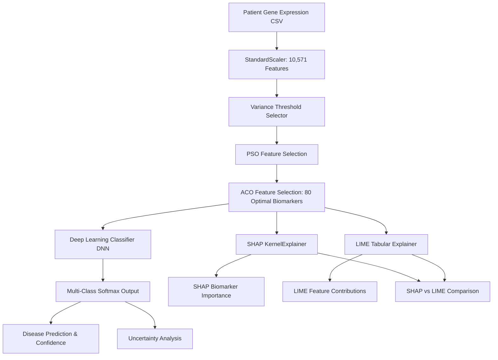

<div align="center">

# 🧬 Explainable Multi-Disease Diagnosis System
### Gene Expression–Based Disease Prediction using Hybrid Swarm Intelligence (PSO + ACO) and Deep Learning

</div>

---

## 📌 Overview

This project provides an end-to-end clinical decision-support application for multi-disease diagnosis based on high-dimensional gene expression profiles (microarray data). It integrates a multi-stage feature selection pipeline combining **Variance Filtering**, **Particle Swarm Optimization (PSO)**, and **Ant Colony Optimization (ACO)** with a **Deep Neural Network (DNN)** and **Explainable AI (XAI)** interpretability engines (**SHAP** & **LIME**).

### 🎯 Target Diseases
| Class ID | Disease | GEO Dataset | Samples |
| :--- | :--- | :--- | :--- |
| **0** | **Coronary Artery Disease (CAD)** | GSE66360 | 99 |
| **1** | **Autoimmune Disease** | GSE50772 | 81 |
| **2** | **Alzheimer's Disease** | GSE48350 | 253 |
| **3** | **Parkinson's Disease** | GSE6613 | 50 |

**Total training samples:** 483 (after filtering Parkinson's controls)

---

## 🏗️ Architecture & Pipeline Flow



### 1. Data Preprocessing & Hybrid Swarm Feature Selection
1. **StandardScaler (`scaler.pkl`)**: Standardizes 10,571 gene expression probe values.
2. **Variance Thresholding (`variance_selector.pkl`)**: Filters out zero/low-variance features.
3. **Particle Swarm Optimization (PSO - `pso_features.pkl`)**: Explores global feature space to reduce dimensions to 500 candidate genes.
4. **Ant Colony Optimization (ACO - `aco_features.pkl`)**: Fine-tunes selection using pheromone-based heuristic search down to **80 optimal biomarker genes**.

### 2. Deep Learning Classifier (`hybrid_pso_aco_dl_model.keras`)
- **Input Dimension**: `(Batch, 80)`
- **Architecture**:
  ```
  Dense(64, relu) → Dropout(0.3) → Dense(32, relu) → Dropout(0.3) → Dense(4, softmax)
  ```
- **Output**: 4-class softmax probabilities (CAD, Autoimmune, Alzheimer's, Parkinson's)

### 3. Explainable AI (XAI) Framework
- **SHAP**: `KernelExplainer` on reference training features measures Shapley contributions of top biomarkers.
- **LIME**: `LimeTabularExplainer` builds local linear surrogate models explaining feature contributions.
- **Comparison**: Automatic SHAP vs LIME comparison with Spearman rank correlation.

---

## 📂 Project Structure

```
gene_disease_app/
├── app.py                            # Streamlit landing page
├── run.sh                            # One-click startup script
├── train_model.py                    # Retraining script (PSO + ACO from scratch)
├── requirements.txt                  # Python dependencies
│
├── core/                             # Core prediction logic
│   ├── config.py                     # Centralised application configuration
│   ├── pipeline.py                   # Canonical preprocessing pipeline
│   ├── predictor.py                  # Model loading & prediction (cached)
│   ├── validation.py                 # Input data validation
│   └── batch_predictor.py            # Batch prediction logic
│
├── explainability/                   # XAI modules
│   ├── shap_explainer.py             # SHAP KernelExplainer wrapper
│   ├── lime_explainer.py             # LIME TabularExplainer wrapper
│   └── comparison.py                 # SHAP vs LIME comparison with Spearman ρ
│
├── pages/                            # Streamlit multi-page app
│   ├── 1_Diagnosis.py                # Single-sample prediction + XAI + PDF
│   ├── 2_Model_Performance.py        # Evaluation metrics, ROC, confusion matrix
│   ├── 3_Model_Comparison.py         # Feature-selection strategy comparison
│   ├── 4_Biomarker_Analysis.py       # Global & disease-specific biomarker ranking
│   ├── 5_Dataset_Visualization.py    # PCA, t-SNE, UMAP, heatmap
│   ├── 6_Explainability.py           # SHAP vs LIME comparison page
│   └── 7_Batch_Analysis.py           # Multi-sample batch prediction
│
├── evaluation/                       # Model evaluation
│   ├── evaluator.py                  # GSE data loading + full pipeline evaluation
│   ├── metrics.py                    # Accuracy, F1, ROC-AUC, per-class metrics
│   ├── plots.py                      # Plotly confusion matrix, ROC, PR curves
│   └── model_comparison.py           # Feature-selection strategy experiments
│
├── visualization/                    # Data visualisation
│   ├── data_loader.py                # Load/prepare data for all viz methods
│   ├── pca.py                        # PCA with explained variance
│   ├── tsne.py                       # t-SNE with configurable parameters
│   ├── umap.py                       # UMAP manifold visualization
│   └── heatmap.py                    # Biomarker expression heatmap
│
├── biomarkers/                       # Biomarker analysis
│   ├── analyzer.py                   # SHAP-based biomarker aggregation
│   ├── ranking.py                    # Global & disease-specific ranking
│   └── metadata.py                   # Probe ID information
│
├── reports/                          # Report generation
│   └── pdf_report.py                 # PDF analysis report (ReportLab)
│
├── utils/                            # Shared utilities
│   ├── constants.py                  # Disease labels, feature counts, paths
│   ├── helpers.py                    # Formatting, feature name utilities
│   └── uncertainty.py                # Entropy, confidence, calibration
│
├── artifacts/                        # Trained model artefacts
│   ├── hybrid_pso_aco_dl_model.keras # Trained DNN
│   ├── scaler.pkl                    # StandardScaler
│   ├── variance_selector.pkl         # VarianceThreshold
│   ├── pso_features.pkl              # PSO-selected feature indices (500)
│   ├── aco_features.pkl              # ACO-selected feature indices (80)
│   ├── X_train_fs.npy                # Preprocessed training features (386×80)
│   └── training_info.json            # Training metadata
│
├── data/
│   ├── sample/                       # Sample patient CSVs for testing
│   │   ├── cad_test_sample.csv
│   │   ├── autoimmune_test_sample.csv
│   │   ├── alzheimers_test_sample.csv
│   │   └── parkinsons_test_sample.csv
│   ├── evaluation/                   # Saved evaluation results
│   └── visualizations/               # Cached PCA/t-SNE/UMAP coordinates
│
└── README.md
```

---

## 🔗 How the Prediction Pipeline Works

Every page that needs predictions uses the **same canonical pipeline**:

```python
from core.pipeline import preprocess
from core.predictor import load_artifacts, predict

# 1. Load artefacts (cached automatically by Streamlit)
artifacts = load_artifacts()

# 2. Preprocess raw input → (1, 80) feature vector
x_final = preprocess(raw_input_df)

# 3. Get softmax probabilities
probs = predict(artifacts, x_final)
pred_class = int(np.argmax(probs))
```

This guarantees that **no page duplicates preprocessing or model-loading code**.

---

## 📊 Pages & Features

### 1. 🩺 Diagnosis (`1_Diagnosis.py`)
- Upload a single gene-expression CSV
- Input validation with detailed error reporting
- Disease prediction with confidence level (High/Medium/Low/Very Low)
- Uncertainty analysis (entropy, probability validation)
- SHAP and LIME explanations
- PDF report generation

### 2. 📈 Model Performance (`2_Model_Performance.py`)
- Accuracy, Precision, Recall, F1, ROC-AUC metrics
- Confusion matrix (interactive Plotly heatmap)
- ROC curves and Precision-Recall curves
- Per-class performance breakdown

### 3. ⚖️ Model Comparison (`3_Model_Comparison.py`)
- Compares 5 feature-selection strategies:
  - No selection (10,571 features)
  - Variance filtering only
  - PSO only
  - ACO only
  - Hybrid PSO + ACO (production)
- Accuracy, F1, feature count, and reduction percentage charts

### 4. 🧬 Biomarker Analysis (`4_Biomarker_Analysis.py`)
- Global biomarker ranking by SHAP importance
- Disease-specific biomarker ranking
- Top 10/20/30/50/80 selection
- Positive vs negative SHAP contributions
- Feature selection journey visualization (10,571 → 80)

### 5. 🔬 Dataset Visualization (`5_Dataset_Visualization.py`)
- PCA with explained variance ratio
- t-SNE with configurable perplexity
- UMAP with configurable neighbors/min_dist
- Biomarker expression heatmap

### 6. 🔍 Explainability (`6_Explainability.py`)
- SHAP explanation for predicted disease
- LIME explanation for predicted disease
- Side-by-side comparison with Spearman rank correlation
- Common feature overlap analysis

### 7. 📦 Batch Analysis (`7_Batch_Analysis.py`)
- Upload multiple CSV files simultaneously
- Individual file validation (invalid files rejected gracefully)
- Progress bar during batch processing
- Results table with all class probabilities
- CSV export of results

---

## 🚀 How to Run

### Method 1: Automated Script
```bash
cd gene_disease_app
chmod +x run.sh
./run.sh
```

### Method 2: Using `uv`
```bash
cd gene_disease_app
uv venv --python 3.11 .venv
uv pip install --python .venv/bin/python -r requirements.txt
.venv/bin/streamlit run app.py
```

### Method 3: Standard Python
```bash
cd gene_disease_app
python3 -m venv .venv
source .venv/bin/activate
pip install -r requirements.txt
streamlit run app.py
```

Access at: **`http://localhost:8501`**

---

## 🧪 Testing with Sample Data

Sample CSVs are in `data/sample/`:

| File | Disease |
|------|---------|
| `cad_test_sample.csv` | Coronary Artery Disease |
| `autoimmune_test_sample.csv` | Autoimmune Disease |
| `alzheimers_test_sample.csv` | Alzheimer's Disease |
| `parkinsons_test_sample.csv` | Parkinson's Disease |

---

## 🔧 Retraining the Model

If you need to retrain (e.g., after adding/removing a disease class):

```bash
.venv/bin/python train_model.py
```

This will:
1. Parse all 4 GSE Series Matrix files
2. Filter Parkinson's to disease samples only (excludes controls)
3. Apply StandardScaler → VarianceThreshold → SelectKBest
4. Run PSO feature selection (10,571 → 500)
5. Run ACO feature selection (500 → 80)
6. Train the DNN
7. Save all new artifacts to `artifacts/`

---

## 🔧 Adding New Features

1. **New page**: Create `pages/N_YourPage.py` — it auto-appears in the sidebar.
2. **Need predictions?**: Import from `core.pipeline` and `core.predictor`.
3. **Need XAI?**: Import from `explainability.shap_explainer` / `explainability.lime_explainer`.
4. **Need constants?**: Import from `utils.constants` or `core.config`.
5. **Add new constants**: Edit `utils/constants.py` (single source of truth).

---

## ⚠️ Limitations

- **No independent test set**: Evaluation data overlaps with training data (same GEO Series Matrix files).
- **Class imbalance**: Alzheimer's has 253 samples vs Parkinson's with 50, which may affect CAD/Parkinson's classification.
- **No biological gene annotation**: Feature identifiers are Affymetrix probe IDs (e.g., `219170_at`), not gene symbols.
- **Softmax ≠ clinical probability**: Model outputs are not calibrated clinical confidence scores.
