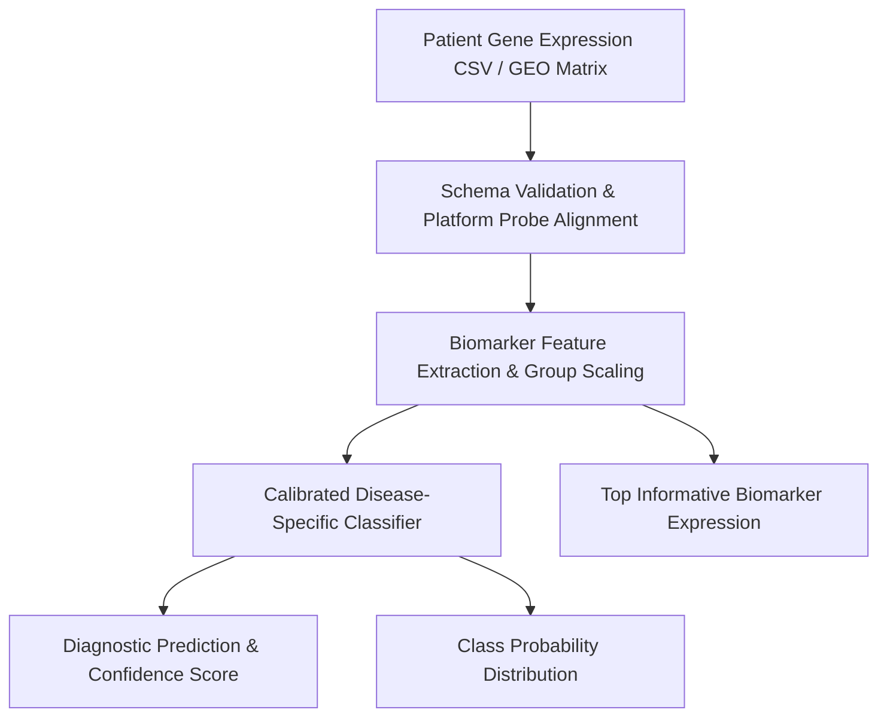

<div align="center">

# 🧬 Explainable Multi-Disease Diagnosis System
### Gene Expression–Based Disease Prediction & Biomarker Discovery across Curated GEO Cohorts

</div>

---

## 📌 Overview

This project provides an end-to-end clinical decision-support application for multi-disease diagnosis based on high-dimensional gene expression profiles (microarrays). It features disease-specific machine learning classifiers calibrated across curated NCBI Gene Expression Omnibus (GEO) series matrix datasets using strict group-aware patient isolation to eliminate data leakage.

### 🎯 Supported Disease Modules

| Target Disease | NCBI Study | Biological Specimen | Biomarker Probes | Model Architecture |
| :--- | :--- | :--- | :--- | :--- |
| **Coronary Artery Disease / AMI** | `GSE66360` | Peripheral Blood (PBMC) | 30 Probes | Random Forest |
| **Alzheimer's Disease** | `GSE48350` | Post-Mortem Brain Cortex | 150 Probes | Logistic Regression |
| **Asthma** | `GSE69683` | Induced Sputum & Epithelium | 100 Probes | Logistic Regression |
| **Heart Failure** | `GSE57338` | Left Ventricular Myocardium | 100 Probes | Random Forest |
| **Lung Adenocarcinoma** | `GSE75037` | Pulmonary Tumor vs. Normal | 100 Probes | Logistic Regression |

---

## 🏗️ Architecture & Pipeline Flow



1. **Data Ingestion**: Accepts single-patient microarray CSVs or standard NCBI GEO Series Matrix archives (`.txt`, `.gz`).
2. **Schema Alignment**: Automatically verifies probe IDs against platform microarray schemas (Affymetrix HG-U133 / HumanHT-12).
3. **Biomarker Selection**: Isolates high-variance, statistically discriminative probe signatures.
4. **Diagnostic Inference**: Outputs calibrated risk probabilities, condition classification, and top biomarker expression.

---

## 📂 Project Structure

```
Multi-Disease-Diagnosis-System/
├── app.py                            # Streamlit landing page & overview
├── run.sh                            # Local startup script
├── start.sh                          # Production startup script
├── train_disease_models.py           # Model training pipeline
├── requirements.txt                  # Python dependencies
├── Dockerfile                        # Container specification
├── render.yaml                       # Render deployment manifest
│
├── core/                             # Core inference logic
│   ├── disease_models.py             # Model loading, parsing & prediction
│   ├── feature_selectors.py          # Ranked feature selection estimator
│   └── geo.py                        # GEO series matrix parser
│
├── pages/                            # Multi-page application
│   ├── 1_Diagnosis.py                # Patient expression diagnosis & pipeline execution
│   └── 2_Model_Performance.py        # Held-out 70–30 evaluation benchmarks
│
├── artifacts/
│   └── disease_models/               # Serialized models, feature schemas, and metadata
│       ├── cad/                      # Coronary artery disease model
│       ├── alzheimers/               # Alzheimer's disease model
│       ├── asthma/                   # Asthma model
│       ├── heart_failure/            # Heart failure model
│       └── lung_adenocarcinoma/      # Lung adenocarcinoma model
│
├── predictions/                      # Curated test samples for patient evaluation
│   ├── cad_person_1_control.csv
│   ├── cad_person_2_case.csv
│   └── ...
│
└── utils/                            # UI theme & styling
    └── theme.py                      # Dark theme configuration & UI animations
```

---

## 🚀 Quick Start

### Local Setup

1. **Clone the repository:**
   ```bash
   git clone https://github.com/Naresh-official/Multi-Disease-Diagnosis-System.git
   cd Multi-Disease-Diagnosis-System
   ```

2. **Create and activate a virtual environment:**
   ```bash
   python3.11 -m venv .venv
   source .venv/bin/activate
   pip install -r requirements.txt
   ```

3. **Launch the Streamlit app:**
   ```bash
   ./run.sh
   # Or directly:
   streamlit run app.py
   ```

4. **Access the application:**  
   Open your browser at `http://localhost:8501`.

---

## 🧪 Testing Patient Profiles

Sample patient gene expression profiles are provided in the `predictions/` directory:
- Upload any of the sample CSV files (e.g. `cad_person_2_case.csv` or `alzheimers_person_1_control.csv`) on the **1 Diagnosis** page to test the automated pipeline, probe alignment, and risk prediction.

---

## ⚠️ Disclaimer

This system is an academic research prototype designed for clinical decision-support exploration. Model performance is estimated on study-internal held-out test splits. Outputs do not constitute standalone clinical diagnoses.
